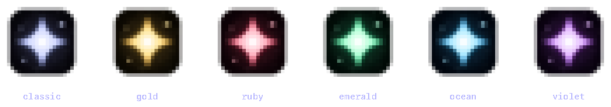

<div align="center">



<br>

[](#-установка)
[](https://github.com/dlyavasnet/shinegram/actions/workflows/build.yml)
[](LICENSE)
[](https://t.me/dlyavasnet)

```text
  ┌──────────────────────────────────────────────────────────────┐
  │ клиент для macOS на исходниках Telegram, с функциями AyuGram │
  │  читай тихо · смотри анонимно · ничего не теряй              │
  └──────────────────────────────────────────────────────────────┘
```

</div>


## `$ shinegram --features`

<div align="center">

</div>


## `$ shinegram ghost --on`

<table>
<tr>
<td width="200" align="center">

</td>
<td>

```console
$ shinegram ghost --status
  read_receipts   ░░░░░░░░░░  hidden
  online          ░░░░░░░░░░  hidden
  typing          ░░░░░░░░░░  hidden
  stories         ░░░░░░░░░░  hidden
  voice_played    ░░░░░░░░░░  hidden
  send_scheduled  ██████████  +12s
> ghost mode: ACTIVE 👻
```

</td>
</tr>
</table>

**Режим призрака** включается одной кнопкой с призраком вверху списка чатов. Подробная настройка: `Настройки → ShineGram`.

> [!NOTE]
> Сервер Telegram сам помечает чат прочитанным, когда ты туда пишешь. Поэтому в режиме призрака сообщения уходят как **отложенные на 12 секунд**: чат остаётся непрочитанным, а ты не появляешься в сети. Исключения: «Избранное», секретные чаты и боты.


## `$ ls ~/shinegram/icons`

<div align="center">

</div>

```console
$ shinegram icon --set ruby
✓ dock icon updated  →  ruby
```

Шесть иконок со звездой: `starlight` · `gold` · `ruby` · `emerald` · `ocean` · `nebula`. Выбираются в `Настройки → ShineGram → Иконка приложения`, Dock обновляется сразу.


## `$ shinegram --help`

```text
USAGE
  ShineGram.app  [модули]

GHOST
  ghost.read_receipts      не отправлять отметку о прочтении
  ghost.online             не отправлять статус «в сети»
  ghost.typing             не отправлять «печатает…»
  ghost.stories            смотреть истории анонимно
  ghost.voice              не отмечать голосовые и кружки прослушанными
  ghost.send_scheduled     не читать чат при отправке (+12 с)

MESSAGES
  anti_delete              удалённые сообщения остаются с пометкой «удалено»   [по умолчанию: on]
  edit_history             прошлые версии сообщений в контекстном меню         [по умолчанию: on]
  no_ads                   скрыть спонсорские сообщения                       [по умолчанию: on]

INTERFACE
  streamer_mode            окна не видны на скриншотах и в записи экрана
  hide_stories             убрать полосу историй
  message_seconds          время сообщений с секундами: 14:05:37
  copy_id                  «Копировать ID» чата, отправителя и сообщения       [по умолчанию: on]
  app_icon                 6 иконок для Dock

LANG
  ru / en                  переключается вместе с языком Telegram
```


## `$ install shinegram`

<a id="-установка"></a>

```bash
# 1 · скачай ShineGram-x86_64.zip или .dmg
open https://github.com/dlyavasnet/shinegram/actions/workflows/build.yml

# 2 · перетащи ShineGram в «Программы»

# 3 · сними карантин: приложение не подписано сертификатом Apple
xattr -cr /Applications/ShineGram.app

# 4 · запускай ✦
open -a ShineGram
```

> [!TIP]
> Если macOS пишет, что разработчик не проверен: правый клик по ShineGram → **Открыть**.


## `$ make build`

На Mac ничего собирать не нужно: всё собирает **GitHub Actions**.

```console
$ gh workflow run build.yml -f arch=x86_64    # или arm64 / universal
$ gh run watch
  ✓ checkout + submodules
  ✓ apply shine/patches/telegram-ios.patch
  ✓ native libs (из кэша)
  ✓ xcodebuild -scheme Release
  ✓ ShineGram-x86_64.zip
```

Секреты репозитория: `TG_API_ID` и `TG_API_HASH`, получить их можно на [my.telegram.org](https://my.telegram.org/apps).

```text
shinegram/
├── shine/
│   ├── patches/telegram-ios.patch   ← ядро: ghost, anti-delete, history
│   ├── icon/render-icon.swift       ← генератор иконки
│   └── readme/                      ← пиксельные картинки этого README
├── packages/SettingsUI/…/Shine*     ← экран ShineGram, иконки, стример
├── packages/ChatListUI/…/ShineGhostButton.swift
└── .github/workflows/build.yml
```


## `$ cat CREDITS`

```text
based on   Telegram for macOS · github.com/TelegramMessenger/telegram-macos
inspired   AyuGram
license    GNU GPL v2.0
```

ShineGram — неофициальный клиент. Он не связан с Telegram FZ-LLC и не одобрен ею. Используешь на свой страх и риск.

<div align="center">

<br>

```text
✦  made with shine  ✦  t.me/dlyavasnet  ✦
```

</div>
